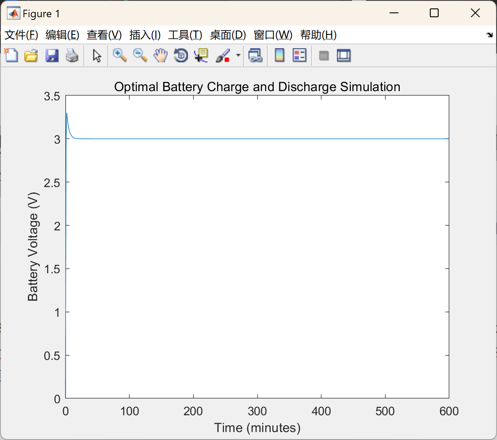

# Simulate the charging and discharging behavior of a battery system, considering various parameters and constraints (Matlab code implementation)

The behavior of the battery, taking into account parameters such as maximum and minimum capacity, charging and discharging currents, and voltage limits.
This MATLAB code aims to simulate the charging and discharging behavior of a battery system, considering various parameters and constraints. Key parameters include the maximum and minimum battery capacity (in mAh), charging and discharging currents, and voltage limits for charging and discharging. The simulation is conducted over a specified duration with a defined time step.
The code initializes the battery capacity to its maximum value and then simulates the behavior of the battery during iterations over time. It handles both charging and discharging phases, adjusting current and voltage according to defined limits. The simulation ensures that the voltage of the battery remains within the specified charging and discharging voltage limits throughout the process.

## Images

<!-- PAYMENT_BLOCK -->

## Get this dataset

- Payment link (Stripe): [Buy now](https://buy.stripe.com/3cs8yP7sY87d0vu9AB)
- Payment QR code: 

<!-- /PAYMENT_BLOCK -->
